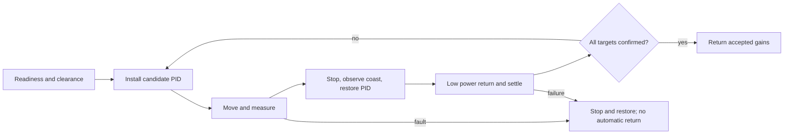

# Guantune

A PROS/LemLib PID tuner that runs measured trials, adjusts gains, and returns to
the saved starting pose between attempts. It supports lateral moves and angular
turns, multiple target distances, battery logging and independent measurement checks.
Optional bounded telemetry records tuning/return kinematics and PROS motor
voltage, current and temperature for CSV export; see the tuning reference for
command-probe requirements and units.

**Status:** sanitizer host tests, seeded physics tests, and a local ARM library/
template build, template installation, and consumer link pass with PROS 4.2.1 /
LemLib 0.5.6. Remote CI runs and robot sessions still require validation.
The simulation is a limited motor model, not evidence of hardware convergence.

## Install

Use PROS kernel 4.2.1 with LemLib 0.5.6. Copy include/autotune/ and src/autotune/
into an existing PROS project, preserving paths. Keep your chassis/odometry setup.
See [compatibility and template builds](docs/compatibility.md) for reproducible
setup and the pinned/latest CI matrix. The library needs C++17 or newer.

## Quick start

After successful calibration, with exclusive drivetrain access and a clear path:

```cpp
#include "autotune/lemlib_tuning_drive.hpp"
#include "autotune/output.hpp"

// Inside autonomous(), using your configured chassis:
auto result = guantune::tuneLateral(chassis);
if (result.status == guantune::AutonTuneStatus::COMPLETE) {
    bool saved = guantune::saveAcceptedGains(result, "/usd/guantune.json");
    // Check saved; print controllerSettingsSnippet(result) if SD is unavailable.
    (void)saved;
}
```

For explicit readiness, clearance confirmation, multiple targets or custom search,
configure AutonTuneConfig and use SelfTuningAuton with LemLibTuningDrive. Read the
[configuration and algorithm reference](docs/tuning.md) before robot testing.
Accepted gains are returned, and the original PID is restored on exit.



## Validation and help

- [Tuning reference and limits](docs/tuning.md)
- [Troubleshooting and failure state](docs/troubleshooting.md)
- [Hardware validation log and reporting protocol](docs/hardware-validation.md)
- [Dependency compatibility evidence](docs/compatibility.md)
- [Contributing and test commands](CONTRIBUTING.md)

Run `bash scripts/test_host.sh` for host tests with ASan/UBSan. CI tests GCC and
Clang in C++17/C++20 and builds the adapter against real PROS/LemLib headers.
Guantune is MIT licensed; upstream dependencies retain their own licenses.
