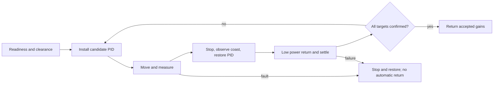

# Guantune

A PROS/LemLib PID tuner that runs measured trials, adjusts gains, and returns to
the saved starting pose between attempts. It supports lateral moves and angular
turns, multiple target distances, battery protection, and independent measurement
checks. Optional bounded telemetry records motion and motor readings for CSV
export without performing file writes in the control loop.

**Status:** sanitizer host tests, seeded physics tests, and a local ARM library/
template build, template installation, and monolithic/hot-cold consumer links
pass locally with PROS 4.2.2 / ARM GCC 14.3.1 / LemLib 0.5.6 for the
current replacement integration.
The current integration has local validation; remote CI for these uncommitted
changes and physical robot sessions remain pending.
The simulation is a limited motor model, not evidence of hardware convergence.

## Install

Use PROS kernel 4.2.2 with LemLib 0.5.6. Copy include/autotune/ and src/autotune/
into an existing PROS project, preserving paths. Keep your chassis/odometry setup.
See [compatibility and template builds](docs/compatibility.md) for reproducible
setup and the pinned/legacy/latest CI matrix. The core needs C++17 or newer;
PROS 4.2.2's build uses C++26 by default. The
[size investigation](docs/package-size.md) explains template and robot binary sizes.

## Quick start

After successful calibration, with exclusive drivetrain access and a clear path:

```cpp
#include "autotune/lemlib_tuning_drive.hpp"
#include "autotune/output.hpp"

// At the start of autonomous() or opcontrol(), before joystick writes:
auto result = guantune::tuneLateral(chassis);
std::printf("Guantune: %s\n", guantune::statusName(result.status));
if (result.status == guantune::AutonTuneStatus::COMPLETE) {
    bool saved = guantune::saveAcceptedGains(result, "/usd/guantune.json");
    // Check saved; print controllerSettingsSnippet(result) if SD is unavailable.
    (void)saved;
}
```

For driver control, use the [opcontrol example](examples/opcontrol.cpp): tuning
starts automatically on entry, with no controller button presses, and runs
synchronously before joystick writes begin. It returns on completion, the
configured trial limit (20 by default), or a fault; it does not restart itself.
Other tasks must also yield drivetrain ownership. Enabled driver control is supported;
the robot does not need to be in autonomous mode. Print the returned status even
when tuning fails, so an early exit is visible.

For explicit readiness, clearance confirmation, multiple targets or custom search,
configure AutonTuneConfig and use SelfTuningAuton with LemLibTuningDrive. Read the
[configuration and algorithm reference](docs/tuning.md) before robot testing.
Accepted gains are returned, and the original PID is restored on exit.



## Reading the implementation

Start with the [code map](docs/architecture.md) for the module boundaries,
session sequence, units, and cleanup rules. See the
[replacement integration notes](docs/pasted-implementation.md) for the new gain
schedule, abort behavior, return handling, and telemetry limits. Existing callers
can include `autotune/self_tuning_auton.hpp` or `autotune/api.hpp`. When copying the
library, copy all of `include/autotune/` and `src/autotune/`; the core now spans
several source files.

## Validation and help

- [Tuning reference and limits](docs/tuning.md)
- [Troubleshooting and failure state](docs/troubleshooting.md)
- [Hardware validation log and reporting protocol](docs/hardware-validation.md)
- [Dependency compatibility evidence](docs/compatibility.md)
- [Contributing and test commands](CONTRIBUTING.md)

Run `bash scripts/test_host.sh` for host tests with ASan/UBSan. CI tests GCC and
Clang in C++17/C++20 and builds the adapter against real PROS/LemLib headers.
Guantune is MIT licensed; upstream dependencies retain their own licenses.
