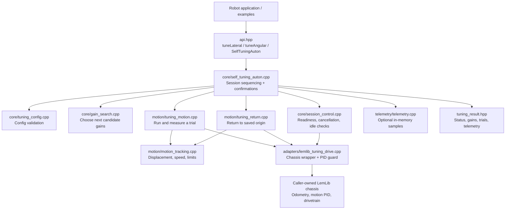
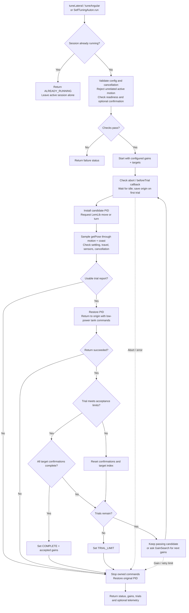

# Code structure and flow

These Mermaid diagrams show the chassis-based tuner. Arrows in the structure
diagram mean “uses.” All public and internal headers live in `include/autotune/`;
implementations live in `src/autotune/`.

## Code structure

`tuning_config.hpp` and `types.hpp` define session settings and shared values.
The `detail/` headers declare internal helpers. `idle_pid_guard.hpp` handles
temporary PID replacement and restoration. PROS supplies timing, competition
state, and optional motor/battery readings through the adapter. The caller owns
the chassis and decides how to display or save results.

## Session flow

For early failures, cleanup only touches commands and PID state owned by this
session; it does not cancel unrelated motion rejected at entry. A failed session
returns diagnostic gains, not accepted gains. Only `COMPLETE` means every
required confirmation and the final return succeeded. The original PID is
restored on exit; the caller applies successful gains deliberately.

The flow runs synchronously on the calling task. LemLib owns motion execution
and odometry; Guantune measures and adjusts gains between trials. See
[getting started](getting-started.md), [architecture](architecture.md), and
[configuration](tuning.md) for details.
